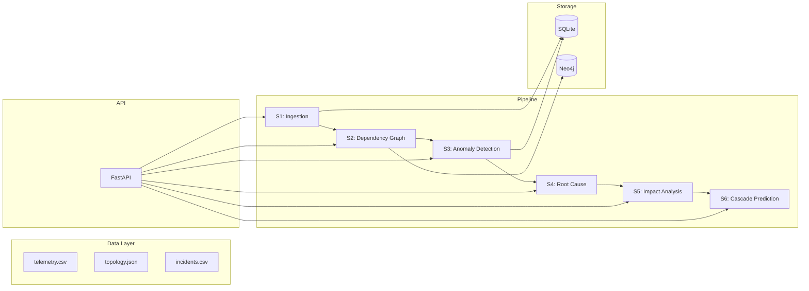

# UPIShield - AI-Powered Resilience Platform for UPI Payments

**Detect, Predict, Recover.** An AI platform for predictive outage prevention in UPI payments.

UPIShield sits **BESIDE** the payment path - never inside it. It ingests operational telemetry, builds a dependency graph ("digital twin"), detects early degradation with an unsupervised ML model, finds probable root causes, forecasts failure cascades with Monte Carlo simulation, and recommends ranked recovery options.

## Architecture



## Quick Start

### Prerequisites

- Python 3.11+
- Docker (for Kafka + Neo4j, optional)

### Installation

```bash
pip install -r requirements.txt
python scripts/generate_data.py --seed 42 --plots
```

### Run the API

```bash
uvicorn app.main:app --reload
```

Then visit http://localhost:8000/docs for the interactive API documentation.

### Run Tests

```bash
pytest -q
```

### Tune & Evaluate

```bash
python -m app.detection.tune
python -m app.detection.evaluate --split test
```

## Demo Sequence

```bash
# 1. Start the API
uvicorn app.main:app --reload

# 2. Check health
curl http://localhost:8000/health

# 3. Get topology
curl http://localhost:8000/api/graph/topology

# 4. Run cascade simulation
curl -X POST http://localhost:8000/api/graph/simulate-cascade \
  -H "Content-Type: application/json" \
  -d '{"failed_node": "bank_a", "trials": 1000, "seed": 42}'

# 5. Get impact analysis
curl http://localhost:8000/api/graph/impact/cloud_region_1

# 6. Reset replay and advance
curl -X POST http://localhost:8000/api/replay/reset -H "Content-Type: application/json" -d '{}'
curl -X POST http://localhost:8000/api/replay/advance -H "Content-Type: application/json" -d '{"minutes": 30}'

# 7. Check alerts
curl http://localhost:8000/api/alerts?status=all

# 8. Get incidents
curl http://localhost:8000/api/incidents
```

## Status Table

| Component | Status | Notes |
|-----------|--------|-------|
| S1: Ingestion (Kafka) | SIMULATED | ReplaySource as fallback; Kafka ready when containers start |
| S2: Dependency Graph (Neo4j) | SIMULATED | NetworkX in-memory; Neo4j ready when container starts |
| S3: Anomaly Detection | BUILT | Per-node Isolation Forest with persistence alerting |
| S4: Root Cause Analysis | BUILT | Graph-aware ranking with victim penalty |
| S5: Impact Analysis | BUILT | Transitive dependants with hop distance |
| S6: Cascade Prediction | BUILT | Monte Carlo with time-to-failure |
| S7: Recommendations | PLANNED | Uses recovery_playbooks.json |
| S8: Approval Workflow | PLANNED | Human-in-the-loop |
| S9: Recovery Execution | PLANNED | Idempotent actions |
| S10: Verification & Report | PLANNED | Post-recovery validation |
| Prometheus/Grafana | OPTIONAL | Metrics endpoint BUILT; full stack via `--profile monitoring` |
| React Dashboard | OUT OF SCOPE | |
| LLM/Ollama | OUT OF SCOPE | |

## Project Structure

```
UPIShield-AI/
  data/               # topology.json, telemetry.csv, incidents.csv
  scripts/
    generate_data.py  # Synthetic data generator
    dev.py            # Docker CLI (up/down/status/seed/reset)
  app/
    main.py           # FastAPI app factory
    config.py         # All constants and assumptions
    graph/
      topology.py     # Load, validate, nx graph, helpers
    cascade/
      engine.py       # Monte Carlo simulation
    data/
      loader.py       # CSV loading and validation
      replay.py       # ReplaySource (EventSource protocol)
    detection/
      features.py     # Causal feature engineering
      model.py        # Per-node Isolation Forest
      alerting.py     # Persistence-based alerting
      baseline.py     # Static threshold baseline
      tune.py         # Hyperparameter tuning
      evaluate.py     # Evaluation on splits
    rca/
      root_cause.py   # Root cause analysis
    api/
      routers/        # FastAPI route handlers
    ingest/           # Kafka producer/consumer (Kafka mode)
    workers/          # Background workers
    monitoring/       # SQLite + Prometheus metrics
  tests/              # pytest test suite
  infra/
    docker-compose.yml
    prometheus.yml    # Optional monitoring profile
  requirements.txt
  README.md
  ASSUMPTIONS.md
  DATA_CARD.md
```

## Limitations

- **All data is synthetic.** No real bank or transaction data is used.
- Propagation probabilities are assumptions, not measured values.
- The generator uses the same propagation probabilities as the cascade engine, so validating cascade predictions against this data would be circular.
- The ML detector is trained on synthetic data and validates the pipeline, not real-world accuracy.
- Kafka and Neo4j are optional; the app works in file mode without Docker.

## License

MIT